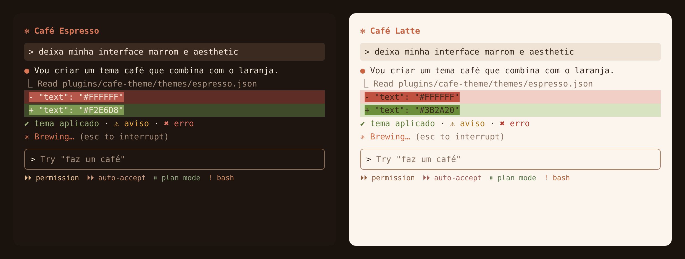

# Mods

Mods para a interface do Claude Code.

## cafe-theme ☕

Temas marrom café que combinam com o laranja do Claude.



- **Café Espresso**: escuro, com texto creme, bordas caramelo e acentos em areia e terracota
- **Café Latte**: claro, com fundo creme e texto marrom espresso

### Mac: um comando só (Claude Code + Terminal)

1. Feche o Claude Code, se estiver aberto.
2. Abra o app **Terminal** e cole:

```
curl -fsSL https://raw.githubusercontent.com/fefo-gith/mods/HEAD/install-mac.sh | bash
```

3. Abra o Claude Code de novo com `claude`.

O instalador:

- copia o tema para `~/.claude/themes/cafe-espresso.json` e deixa o Café Espresso como tema padrão do Claude Code (guarda uma cópia da sua config em `~/.claude.json.antes-do-cafe`)
- cria o perfil **Cafe Espresso** no Terminal (fundo `#1E1510`, texto creme, cursor laranja) e o define como padrão para todas as janelas

Para voltar ao normal: no Claude Code, `/theme` → Dark mode; no Terminal, Ajustes → Perfis → escolha outro perfil e clique em Padrão.

### Via plugin

Dentro do Claude Code:

```
/plugin marketplace add fefo-gith/mods
/plugin install cafe-theme@fefo-mods
```

Depois abra `/theme` e escolha **Café Espresso** ou **Café Latte**.
